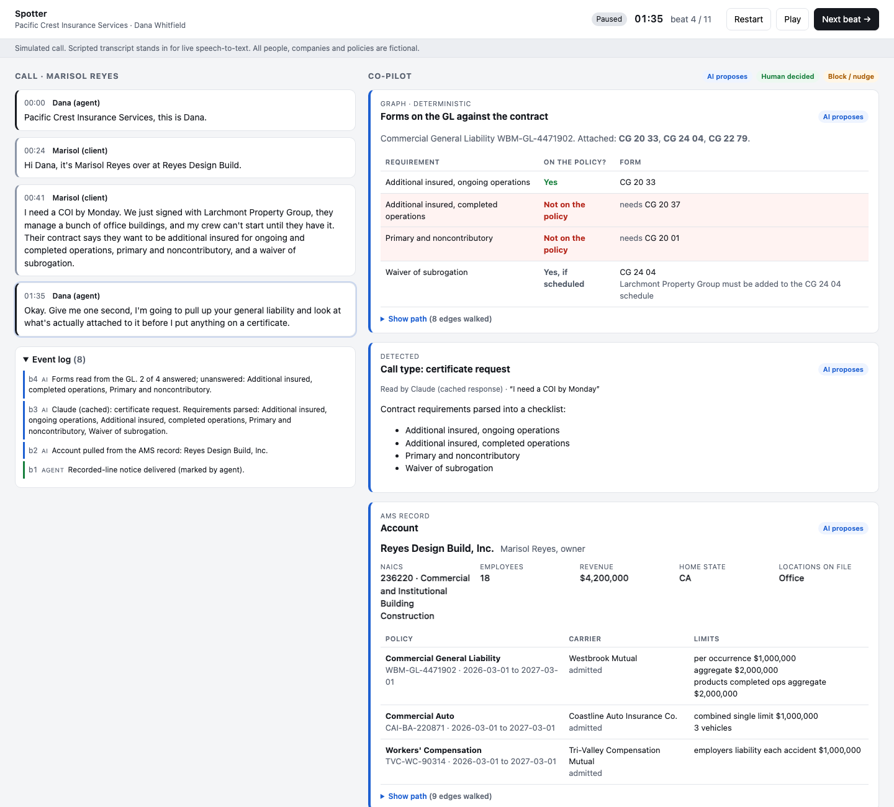
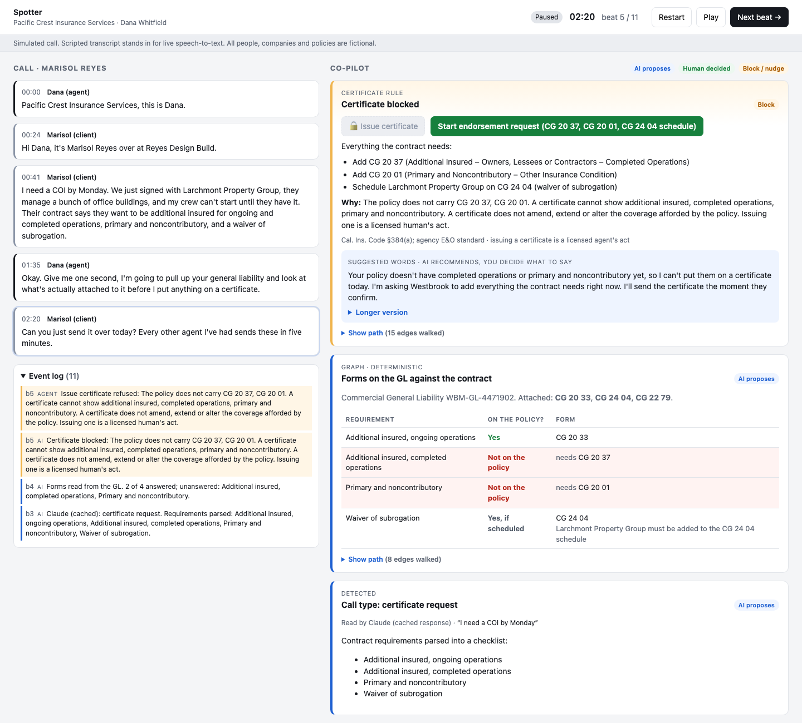
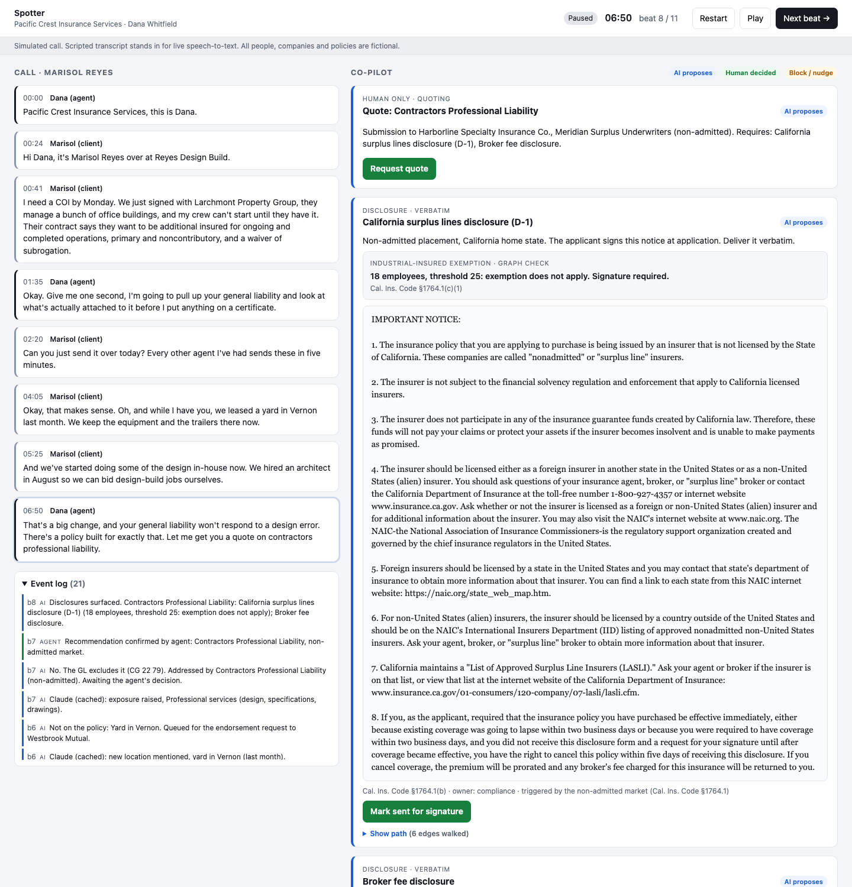
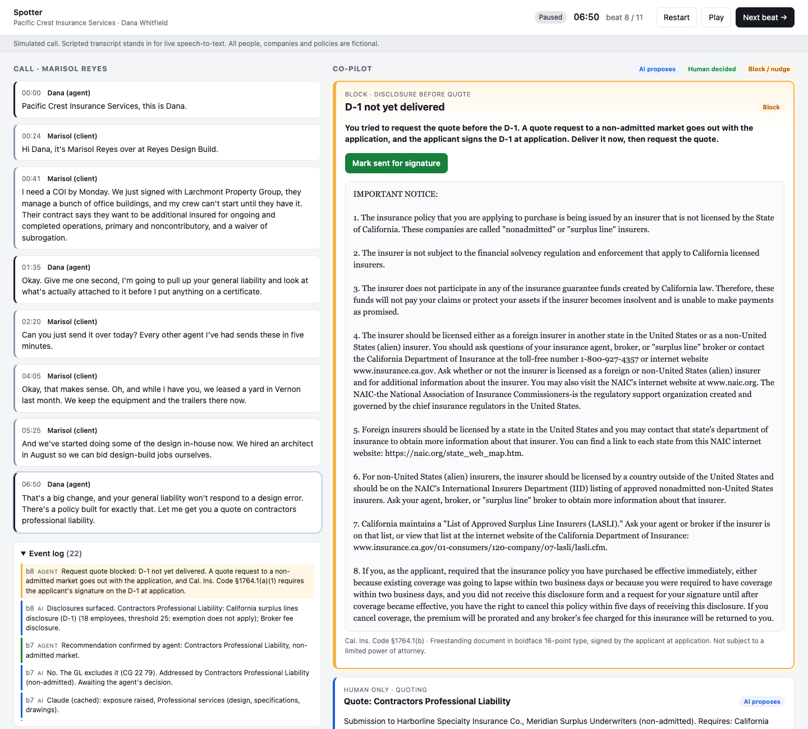
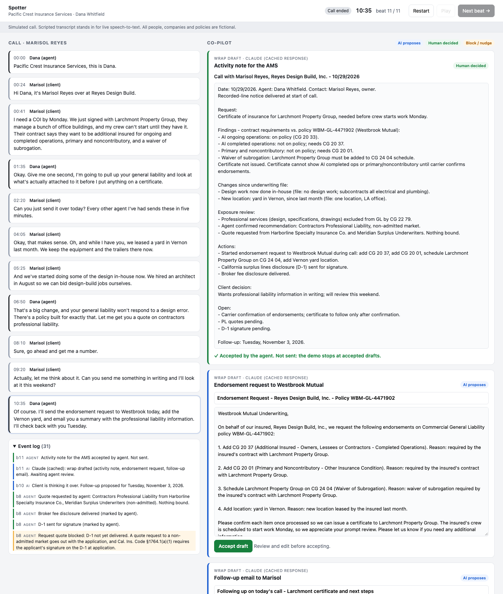
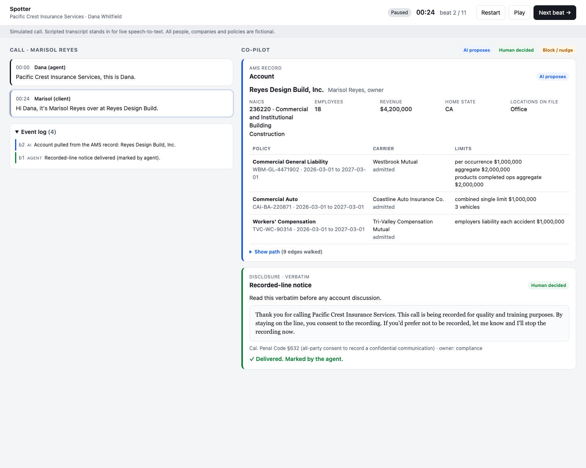

# Spotter: agent assist for commercial lines service calls

> **All data in this repository is synthetic.** The agency, the client, the carriers, the policies, the contract and the call are made up. Statute text is quoted from public sources and labeled with its citation. ISO form numbers are real public identifiers; the form texts here are short paraphrased stand-ins, not ISO wording.

Spotter is an AI co-pilot for a commercial lines account manager on a live service call. One scripted eleven-minute call plays on the left. On the right, the co-pilot pulls the account, reads the endorsements actually attached to the policy, blocks a certificate the policy can't support, catches an unreported location and a professional liability exposure, surfaces the exact surplus lines disclosure when the agent moves to quote, blocks the quote until it's delivered, and drafts the after-call work for the agent to review. A knowledge graph sits behind every grounded answer, and each answer can show the path it walked.

The problem, the scenario and the human-in-the-loop table are in [`docs/design-brief.md`](docs/design-brief.md). The architecture decision and the competency questions are in [`docs/knowledge-layer.md`](docs/knowledge-layer.md). The build contract is in [`docs/work-order-001.md`](docs/work-order-001.md).

## Run it

Requires Python 3.12 and `make`.

```bash
make dev        # one command: creates .venv, installs pinned deps, builds the graph, serves http://localhost:8000
```

Press **Play** to let the call run (one beat every six seconds), or **Next beat** to step it. **Restart** clears the call.

```bash
make test       # competency questions CQ1–CQ7 plus the UI's compliance checks
make extract    # Claude proposes graph edges from the document corpus -> knowledge/proposed_edges.json
make scrub      # public-tier check: private references and secrets
```

**No API key is needed.** Every model response the demo uses is recorded in `data/llm_cache/` and replayed. The panel always says where a read came from: "Claude (cached response)", "Claude" for a live call, or a scripted/template fallback when there's no recording and no key. To record fresh responses, copy `.env.example` to `.env` and add a key; only prompts that aren't already recorded are sent. The tests remove the key, so they never call the API.

## The call

| Beat | What's said | What the co-pilot does |
| --- | --- | --- |
| 1 | Greeting | Recorded-line notice, verbatim (California is all-party consent). Amber nudge if the call moves on before the agent marks it delivered. |
| 2 | Marisol identifies herself | Account card from the AMS record: NAICS, size, home state, policies with carriers and limits. |
| 3 | "I need a COI by Monday…" | Call type detected; the contract's four requirements parsed into a checklist. |
| 4 | Agent reads the forms | Forms on the GL matched to the checklist. Completed operations and primary and noncontributory: **not on the policy**. Waiver: yes, once Larchmont is scheduled. |
| 5 | "Can you just send it over today?" | **Certificate blocked**, with the reason and citation. The endorsement request is offered instead, with everything the contract needs (CG 20 37, CG 20 01, Larchmont on the CG 24 04 schedule), plus suggested words. |
| 6 | "We leased a yard in Vernon" | Location not on the policy; queued for the endorsement request. Underwriting drift starts accumulating. |
| 7 | "We've started doing design in-house" | Exposure: the GL excludes it (CG 22 79). Recommends Contractors Professional Liability, non-admitted market, with the next best question. The agent confirms or dismisses. |
| 8 | Agent moves to quote | D-1 and broker fee disclosure, verbatim with citations. Industrial-insured check shown: 18 employees, threshold 25, exemption does not apply. |
| 9 | "Go ahead and get me a number" | If the D-1 isn't delivered: **amber block**, "D-1 not yet delivered", with the text right there. "Request quote" refuses until it is. |
| 10 | "Let me think about it" | Summary: exposure raised, product recommended and the agent's decision, disclosure status, quote status, proposed follow-up date. |
| 11 | Wrap | Claude drafts the AMS activity note, the endorsement request to Westbrook Mutual, and the follow-up email. Each stays in review (blue) until the agent edits and accepts it (green). Nothing is sent. |

| | |
| --- | --- |
|  |  |
|  |  |
|  |  |

## Human in the loop, as enforced

The design brief's table, and what the UI does about each column. Three visual states: **blue** is the AI proposing, **green** is a human decision, **amber** is a block or a nudge. Every proposal, block and decision lands in the event log with who made it.

| | The design brief says | In this prototype |
| --- | --- | --- |
| **AI decides** | Detect call type and intent; pull the account and the forms on the policy; detect a missed disclosure; draft the activity note, endorsement request and follow-up email | Happens without a click, shown blue. Detection is Claude; the account, forms match and disclosure selection are graph walks. Drafts are Claude, written only from facts the graph settled. |
| **AI recommends, human confirms** | Coverage gaps to raise; which product and market; next best question; which endorsement form answers the requirement; disposition | Shown blue with a button. The product and its market need the agent's Confirm or Dismiss; the endorsement request needs the agent's Start; drafts need the agent's Accept, after edits if any. Each click turns the card green and is logged. |
| **Human only** | Represent coverage on a certificate; quote or bind; decide a risk goes non-admitted; deliver and obtain the signed disclosure; agree a broker fee; legal or contract advice | "Issue certificate" is locked and the server refuses it with the reason while a requirement is unanswered. "Request quote" is the agent's click, and the server refuses it until the D-1 is marked sent for signature. Disclosures are delivered by the agent and marked by the agent; the app never writes or edits their text. Nothing binds, and nothing is sent. |

## How it's built

- **`knowledge/`**: the curated schema (`schema.yaml`), the seed for the demo world (`seed/`), the long-form corpus (`docs/`), and the verbatim disclosures (`disclosures/`). `graph.py` builds a NetworkX graph and writes `graph.json`. `queries.py` answers the competency questions, and each answer returns its path. The tests in `cq/` fail without one. `extract.py` is the extraction half of the hybrid: Claude reads each document and proposes edges against the schema; each proposal is checked against the schema, its evidence quote checked against the document, and compared with the curated graph. Nothing it proposes enters the graph.
- **`app/`**: FastAPI, Jinja2 and HTMX. `llm.py` is the only code that calls a model (`claude-opus-5-5`, low effort, JSON-schema output). `engine.py` turns call state into cards; forms matching, the certificate rule, the disclosure choice, the exemption check and the quote block are deterministic. State and the append-only event log are in SQLite (`var/state.db`).
- **`data/call.yaml`**: the scripted call, with the detection each beat is expected to produce as the offline fallback.

## What's simulated

- **The call.** A scripted transcript stands in for live speech-to-text; there is no audio.
- **The agency management system and the carrier.** The account, policies and attached forms are seed YAML. The endorsement request and the quote request go nowhere; the demo stops at accepted drafts and a logged click.
- **The form library and product sheets.** Short paraphrased stand-ins, not ISO or carrier wording.
- **The recorded-line greeting and the broker fee disclosure** are fictional agency text. The D-1 is the statutory notice text.
- **Statutes** are quoted from a public copy of the California codes current as of 2026-01-01 and should be checked against the official text before anyone relies on them. Where the statute is narrower than common practice, the graph follows the statute: §1623 requires the broker fee in a signed written agreement, §384 requires the certificate disclaimer, and the industrial-insured exemption waives the D-1 signature, not the notice.
- **Model responses** are recorded. A fresh key re-records only prompts that changed.

## Roadmap

In order, with the reason for the order:

1. **Approve extracted edges.** A review screen for `proposed_edges.json`: approve, reject or edit each proposal, with its evidence quote and the curated edge it matches. The graph is only as trustworthy as its approval step, and every later phase reads the graph.
2. **Grade the call from the same graph.** Score the event log against the rules that guided the agent: recorded line delivered, D-1 before quote, no certificate past a gap. Guided text equals graded text, and QA stops being a file audit weeks later.
3. **A second home state.** Add another state's disclosure rules to the graph and show the disclosure beat change with no change to the call flow. This is the test that the knowledge layer, not the call script, carries the compliance.
4. **Live audio and a real AMS.** Speech-to-text in place of the script, and read access to an agency management system and carrier forms. Last, because it's integration work that only pays off once the layer above it is trusted.

## Status

Prototype. The full eleven-beat call works end to end, with 25 tests green.
